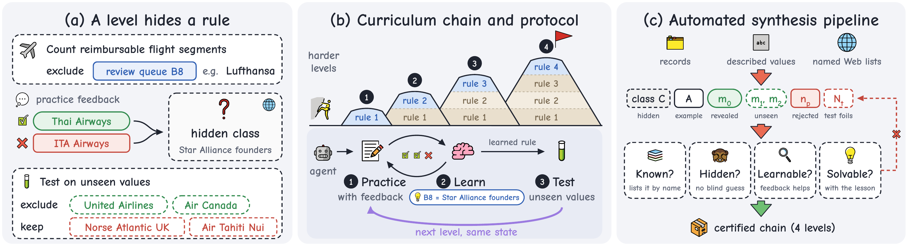
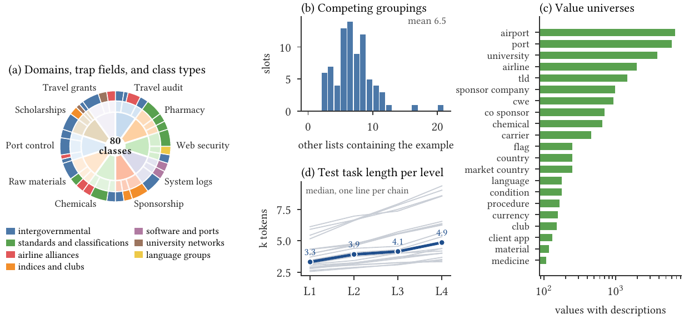
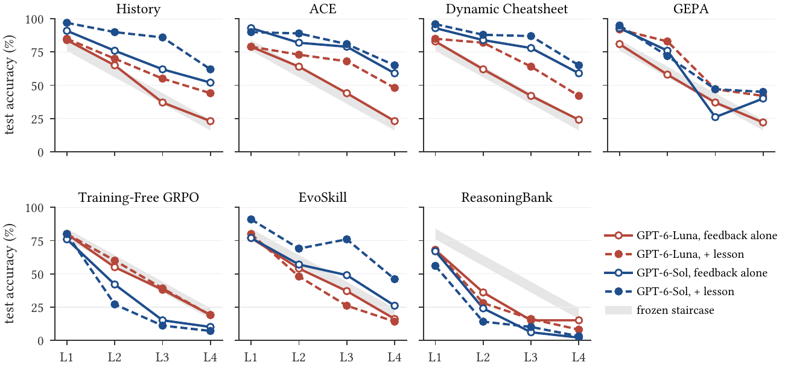
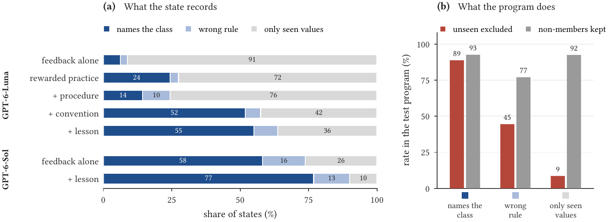

<div align="center">

# CLR-Bench

### 规则越多，清单越长？在隐藏规则课程上评测自进化智能体

**C**urriculum of **L**atent **R**ules（隐藏规则课程）

[](#引用)
[](requirements.txt)
[](LICENSE)

[English](README.md) | **中文**

</div>

<p align="center">
  
</p>

## 简介

自进化智能体会根据反馈改写一份持久状态，比如策略手册、提示词、技能库或记忆库。它们真的学会了没人告诉过它们的规则，还是只是把每次纠错记成一条例外？

CLR-Bench 用**课程链**来回答这个问题。每一级在前面规则的基础上再加一条隐藏规则，例如 *"review queue B8 中的航段不计入"*。每个不透明标签背后都是一个**发布在 Web 上的命名分组**，比如星空联盟的创始成员航空公司。任务只给出一个示例（*Lufthansa*）；练习反馈再揭示一个成员（*Thai Airways*）和一个非成员（*ITA Airways*）；测试则检查智能体从未见过的成员（*United Airlines*）和看起来相似的非成员。

- **练习可以靠例外清单通过**，但只有推断出类别的智能体才能通过测试。
- **经探针认证**：底座模型能按名字知道每个分组，没有反馈时猜不出它，而在"标签代表命名分组"这一约定下能从证据中确定它。
- **可诊断**：单值格准确率和值级诊断把推广不足（未见成员仍被计数）和推广过度（非成员被删掉）区分开。
- **可扩展**：CLR-Synth 流水线能从新的数据领域构建并认证新的链。

## 基准概况

<p align="center">
  
</p>

| | |
|---|---|
| 链 | 20 条（每个领域两条） |
| 领域 | 差旅审计、药房审核、网络安全、系统日志、赞助、化学品进口、原材料、港口检查、奖学金、差旅资助 |
| 每条链的级数 | 4 级（规则逐级累积） |
| 隐藏规则 / 练习任务 / 测试任务 | 80 / 80 / 80 |
| 隐藏类别 | 政府间组织成员、标准与官方分类、航空联盟、股票指数、体育俱乐部等 |
| 评测的方法 | ACE、GEPA、Dynamic Cheatsheet、Training-Free GRPO、EvoSkill、ReasoningBank |
| 参照条件 | 冻结智能体、原始练习记录、加 lesson |

## 主要结果

<p align="center">
  
</p>

平均测试准确率（%，第 1–4 级，20 条链）。*self*：只靠反馈学习。*+ lesson*：在更新步骤中加入一段固定文本，陈述命名分组约定，但不点名任何类别。

| 方法 | GPT-6-Luna self | GPT-6-Luna + lesson | GPT-6-Sol self | GPT-6-Sol + lesson |
|---|---:|---:|---:|---:|
| 冻结智能体 | 47.8 | - | 32.5 | - |
| History（原始练习记录） | 52.3 | 63.5 | 70.3 | 83.8 |
| ACE | 52.5 | 67.0 | 78.3 | 81.3 |
| Dynamic Cheatsheet | 52.8 | **68.3** | **78.5** | **84.0** |
| GEPA | 49.5 | 66.0 | 58.8 | 64.8 |
| Training-Free GRPO | 48.0 | 49.5 | 35.8 | 31.2 |
| EvoSkill | 46.0 | 42.0 | 52.3 | 70.5 |
| ReasoningBank | 33.5 | 30.0 | 24.8 | 20.8 |

**主要发现**
1. 用 GPT-6-Luna 时，这些方法几乎学不会：最好的方法比冻结智能体至多高 5 分，只能排除 6–12% 的未见成员，少于原始练习记录（20%）。加入 lesson 后提高 14.5–16.5 分。
2. 它们的状态把纠错记成例外：被揭示的成员出现在 75–98% 的最终状态中，类名几乎从不出现。
3. 学习能力随底座模型增长：换用 GPT-6-Sol 后，ACE 和 Dynamic Cheatsheet 只靠反馈就能学会（78%），并超过原始练习记录。

<p align="center">
  
</p>

## 快速开始

```bash
pip install -r requirements.txt
python data/unpack_chains.py TR1                     # 解压一条链（不带参数则解压全部）
cd data/chains/TR1
python score_k1_v3.py --version 0 --program L1=controls/reference_L1.py --diagnostics
```

## 仓库结构

```
data/            论文使用的 20 条认证链
  CHAINS.tsv       链 -> 数据集、课程 id、构建配置、种子、流水线版本、类别
  PROVENANCE.md    如何确定最终构建版本；链目录的内容说明
  unpack_chains.py 解压 payload.tar.gz 并按 MANIFEST.sha256 校验
  chains/<chain>/  CHAIN.json、CONCEPTS.json、prompts/、TRAPS/、controls/、评分脚本、payload.tar.gz、run_kit/
pipeline/        CLR-Synth（python -m clrsynth）：检查、候选、探针、认证、构建、校验、复现验证
  inputs/          各领域输入（dataset.py、场景、取值全集、列表库、显著度、链配置、数据源）
  inputs_alt/      MN2 和 UN2 构建所用的输入（见 data/PROVENANCE.md）
  tools/           冻结智能体校准、试运行、rebuild_chain.sh（重建已发布的链并核对清单）
  tests/           使用假端点的离线测试
harness/         评测框架
  runtime/{self,hint,test}/  练习框架（只靠反馈 / 加 lesson）和测试框架：评估器、反馈、求解循环、传输、本地任务服务（sdk/）
  run_dir/         每次运行的驱动：阶段 A（练习）、回放计划、阶段 B（测试）、评分、冻结智能体、参照条件
  setup_run.py     创建一条链的运行目录
  run_condition.sh 在一条链上端到端运行一组 (mode, method)
  gateway.py       连接 OpenAI 兼容接口的本地网关（模型、推理强度、重试、审计）
  summarize.py     跨链汇总分数（各级准确率、单值格、inc_u、exc）
  experiment_scripts/  论文实际运行时用的脚本和补丁（供参考）
methods/         ACE、GEPA、EvoSkill、Dynamic Cheatsheet、ReasoningBank、Training-Free GRPO 的适配代码和不使用方法的参照；
                 UPSTREAM.md、fetch_upstream.sh
prompts/         lesson 及其拆分、GEPA 说明、类名先知文本、Web 检索文本
paper_figures/   画图和制表脚本，以及它们读取的数据文件
```

## 环境要求

Python 3.12（`pip install -r requirements.txt`）。评分和构建链只需要 PyYAML。运行方法需要上游的 ACE、GEPA 和 EvoSkill 代码（`methods/fetch_upstream.sh`），以及一个 OpenAI 兼容的 chat-completions 接口；论文使用的是高推理强度的 GPT-6-Luna 和 GPT-6-Sol。框架会把每个候选程序放在无网络的 Docker 容器中运行（`python:3.12-slim`；`docker pull python:3.12-slim`）。

## 数据

```bash
python data/unpack_chains.py            # 全部链；或：python data/unpack_chains.py TR1 UN2
```

论文使用每条链的第 1–4 级和实例版本 0。

## 构建链

所有流水线命令都在 `pipeline/` 下运行。探针通过以下方式调用被评测的模型：

```bash
export CLRSYNTH_ENDPOINT=https://api.example.com/v1   # OpenAI 兼容的 base URL
export CLRSYNTH_MODEL=gpt-6-luna CLRSYNTH_REASONING=high
export CLRSYNTH_API_KEY_CMD='cat ~/.secrets/key'      # 或 CLRSYNTH_API_KEY；密钥只保存在内存中
cd pipeline
python -m clrsynth lint TR                            # 输入检查
python -m clrsynth screen inputs/TR/chains/TR1.yaml       # 可选：在 make-chain 之前预筛候选列表
python -m clrsynth make-chain inputs/TR/chains/TR1.yaml   # 槽位 -> 候选 -> 探针 -> 构建 -> 检查 -> 复现验证
python tools/frozen.py out/TR/TR1                         # 在三个版本上做冻结智能体校准
```

`make-chain` 可以断点续跑（已确定的槽位保存在 `out/<dataset>/<chain>/STATE.json`）。SY 领域需要 Synthea 样本：`tar -xzf inputs/SY/sources/synthea.tar.gz -C inputs/SY/sources`。原始数据快照（`raw/`）没有随仓库发布；`inputs/<domain>/sources/FETCH.md` 记录了每个数据源的获取方式，派生出的取值全集、列表库和显著度文件已包含在内，因此不需要原始快照也能构建链。

不调用任何模型、检查已发布的链能否复现（从固定槽位重建，并把每个构建文件和输入文件与链的清单比对）：

```bash
pipeline/tools/rebuild_chain.sh TR1 /tmp/clr_rebuild
```

## 在一条链上运行方法

```bash
methods/fetch_upstream.sh                                   # 把 ACE、GEPA、EvoSkill 拉取到 methods/upstream/
export CLRBENCH_API_BASE=https://api.example.com/v1 CLRBENCH_API_KEY=...
python harness/gateway.py --model gpt-6-luna --reasoning high --port 42802 --base-path /CLR &
python data/unpack_chains.py TR1
harness/run_condition.sh TR1 runs/luna "[('self','ace'),('hint','ace'),('self','hist')]" \
    --gateway-url http://localhost:42802/CLR --model gpt-6-luna
```

`mode` 为 `self`（只靠反馈学习）或 `hint`（加 lesson：把 `prompts/lesson.txt` 附加到每次更新的输入）。方法：`ace`、`gepa`、`evoskill`、`dc`（Dynamic Cheatsheet）、`rb`（ReasoningBank）、`tfgrpo`（Training-Free GRPO）；不使用方法的参照：`hist`（原始记录）、`histhint`、`histconv`、`histproc`、`oracle`、`nameoracle`（类名先知）、`nameproc`、`webonly`、`histweb`、`histwebng`（见 `methods/README.md`）。冻结智能体用 `runs/luna/TR1/run_frozen.sh 1 2 3 4` 运行。其他设置：

* `CLRBENCH_GEPA_NOTE=neutral|explicit|none` 选择 GEPA 的格式说明（默认 `neutral`，与主结果一致）。
* 有奖励的练习：`CLR_BUNDLE=bundle_k1_v0_rg`（`run_condition.sh` 只在阶段 A 应用）。
* 更新文本的变体（中性标题下的 lesson 拆分、只在第 1 级给出约定、在更新步骤中给出类名）见 `harness/experiment_scripts/` 中的脚本。

运行目录沿用论文实验的结构：阶段 A 把每级的状态写到 `runs_nc100_<mode>_v0/rep1/<method>/<course>/L<k>/STATE.json`，阶段 B 在测试任务上回放每个状态，写到 `runs_nc100_test/<mode>/<method>/L<k>/`，`score_all.py` 生成 `SCORES_ALL.json`。

## 评分

每条链都自带评分脚本。直接给程序评分：

```bash
cd data/chains/TR1
python score_k1_v3.py --version 0 --program L1=controls/reference_L1.py --program L2=my_L2.py --diagnostics
```

它会输出每一级的得分（通过的格数 / 5）、每个格的结果，加上 `--diagnostics` 时还会输出值级诊断。跨链汇总运行结果：

```bash
python harness/summarize.py runs/luna                       # 准确率、各级、单值格、inc_u、exc
```

## 重新生成图表

```bash
cd paper_figures
for f in figures/make_*.py; do python "$f"; done            # PDF 输出到 figures/，LaTeX 表格输出到 sections/
python figures/build_main_figure.py && sh figures/make_main_figure.sh   # 概览图（需要 headless Chrome、pdfcrop）
```

脚本读取 `paper_figures/data/*.json`，即论文实验汇总后的结果。

## 引用

```bibtex
@article{qiu2026clrbench,
  title  = {More Rules, Longer Lists? Benchmarking Self-Evolving Agents on a Hidden-Rule Curriculum},
  author = {Qiu, Chenjie and Xu, Boyan and Shi, Shaobin and Chen, Bingfeng and Cai, Ruichu and Luo, Dongsheng},
  year   = {2026},
  note   = {arXiv link coming soon}
}
```

## 许可证

待定，见 `LICENSE`。
